# 🤖 Autonomous Web Calculator Agent

Projeto prático de aprendizado focado em **Engenharia de Agentes de IA aplicados ao ciclo de desenvolvimento de software (SDLC)** utilizando **GitHub Actions**.

A proposta é evoluir uma calculadora web de forma incremental — **uma operação por Issue** — onde agentes autônomos recebem a demanda, implementam o código, validam com testes determinísticos, revisam o `git diff` e abrem um Pull Request pronto para aprovação humana (*Human-in-the-Loop*) com deploy automático via **GitHub Pages**.

🌐 **Demo ao vivo:** `https://VitorAlvs.github.io/calculadora-web-agent/`

---

## 🎯 Objetivo

Sair do uso manual de LLMs via chat e construir, na prática, uma esteira autônoma ponta a ponta (*Issue → Código → Testes → Revisão → PR → Deploy*), respondendo a perguntas reais de engenharia:

- Onde a IA realmente precisa agir e onde automação determinística comum resolve melhor?
- Como impedir que um agente quebre código antigo, entre em loop infinito ou altere arquivos sensíveis?
- Como manter custo de tokens previsível e lidar com instabilidades de API (`503`, timeouts, limites de saída)?

---

## 🔄 Workflow Autônomo (Issue → PR → Deploy)

```mermaid
flowchart LR
    A["1. Issue + label agent-ready<br/>(Automação - 0% IA)"] --> B["2. Agente Dev<br/>(IA - Leitura/Escrita)"]
    B --> C["3. Validação & Testes<br/>node --check + node --test<br/>(Automação - 0% IA)"]
    C -- "Falhou (até 3x): devolve erro exato" --> B
    C -- "Passou (exit_code = 0)" --> D["4. Commit na branch & PR<br/>(Automação - 0% IA)"]
    D --> E["5. Agente Revisor<br/>(IA - Somente Leitura)"]
    E --> F["6. Notificação & Merge<br/>(Human-in-the-Loop)"]
    F --> G["7. Deploy Automático<br/>(GitHub Pages)"]
```



1. **Gatilho:** Uma Issue é aberta em inglês e marcada com a label `agent-ready`. O workflow `.github/workflows/agent-dev.yml` só executa se o autor for o dono do repositório.
2. **Agente Dev (`.agent/run_agent.py`):** Lê apenas os arquivos permitidos do repositório + descrição da Issue e retorna o plano de edição em formato JSON estruturado.
3. **Portão Determinístico (`node --check` + `node --test`):** Verifica sintaxe e executa toda a suíte de testes unitários (incluindo regressão das operações anteriores). Se falhar, o erro exato volta para o Agente Dev em um loop *Evaluator-Optimizer* (até `MAX_STEPS = 3`).
4. **Branch e Pull Request:** Com os testes verdes, a esteira cria a branch `agent/issue-<N>`, faz commit/push e abre o PR com relatório de modelo, prompt, tokens gastos e saída dos testes.
5. **Agente Revisor (`.agent/run_reviewer.py`):** Um segundo agente, com contexto isolado e **permissão somente leitura**, analisa o `git diff main...HEAD` contra a Issue original, publica o parecer no PR e marca o mantenedor como *Reviewer*.
6. **Aprovação Humana e Deploy:** Após revisão e merge manual na `main`, o **GitHub Pages** publica a nova versão automaticamente.

---

## 🧠 Arquitetura de IA, Modelos e Integração ("Ponte")

Para manter o orquestrador desacoplado de qualquer fornecedor único, a comunicação com os modelos segue o **padrão de API compatível com OpenAI** usando a SDK oficial `openai` em Python apontando diretamente para a **Gemini API do Google**:

- **Provedor / Endpoint ("Ponte"):** Endpoint oficial OpenAI-compatible do Google AI Studio (`https://generativelanguage.googleapis.com/v1beta/openai/`). Trocar para OpenRouter, Groq, OpenAI ou Ollama local exige alterar apenas as *Repository Secrets*, sem modificar o código Python.
- **Modelo Principal:** `gemini-3.8-flash`
- **Cadeia de Fallback Automático:** `gemini-3.7-flash` → `gemini-3.5-flash-lite` → `gemini-3.1-flash-lite` (com *exponential backoff* para contornar picos de erro `503` ou rate limits).
- **Saídas Estruturadas (*Structured Outputs*):** Contratos validados via **Pydantic** (`AgentCodePlan` e `ReviewVerdict`), com fallback automático para injeção de JSON Schema + parsing local caso algum provedor/modelo rejeite `json_schema` nativo.

---

## 📁 Estrutura do Repositório

```text
calculadora-web-agent/
├── .agent/
│   ├── prompts/
│   │   ├── dev_v1.md            # System prompt versionado do Agente Dev (v1.1.0)
│   │   └── reviewer_v1.md       # System prompt versionado do Agente Revisor (v1.0.0)
│   ├── run_agent.py             # Orquestrador Dev + validação + fallback resiliente
│   └── run_reviewer.py          # Agente Revisor somente leitura (análise de git diff)
├── .github/
│   └── workflows/
│       └── agent-dev.yml        # Esteira CI/CD autônoma disparada por Issues
├── src/
│   ├── app.js                   # Conexão entre DOM e lógica
│   └── calculator.js            # Lógica pura e testável das operações
├── tests/
│   └── calculator.test.js       # Testes unitários nativos (node:test)
├── index.html                   # Interface web
├── style.css                    # Estilização
└── package.json                 # Configuração ES Modules + script de testes
```

---

## 🛡️ Guardrails e Segurança

- **Allowlist de escrita (*Least Privilege*):** O Agente Dev só pode escrever em `index.html`, `style.css`, `src/*.js` e `tests/*.js`. Tentativas de *path traversal* ou edição em `.github/` e `.agent/` são bloqueadas antes de tocar o disco.
- **Trava de autor no workflow:** Apenas Issues criadas pelo `repository_owner` podem acionar os agentes, mitigando *prompt injection* e consumo indevido de cota em repositório público.
- **Circuit Breakers de custo e execução:** Limite de `4.096` tokens por chamada (`max_tokens`), orçamento máximo de `30.000` tokens por execução (`MAX_RUN_TOKENS`), timeout de `45s` por requisição e máximo de `3` ciclos de auto-correção (`MAX_STEPS`).
- **Human-in-the-Loop (HITL):** Os agentes nunca fazem push direto na `main`; o merge final permanece sob controle humano.

---

## 📚 O que eu aprendi na prática

1. **Automação normal segura a esteira; IA só entra onde precisa pensar:** Criar branches, rodar testes, abrir PRs e fazer deploy são etapas determinísticas (0% IA). Misturar tudo no prompt deixa o sistema lento e imprevisível.
2. **Separação entre `/prompts` e código do agente:** Tratar prompts como código versionado (`v1.0.0` → `v1.1.0`) permite auditar na telemetria qual versão de instrução gerou cada resultado.
3. **Economia real de tokens padronizando o repo em inglês:** Migrar código, testes, prompts e Issues para inglês reduziu significativamente a fragmentação de tokens e evitou conflitos de idioma nos testes.
4. **Validação determinística é o que torna o agente confiável:** Sem um runner rápido e objetivo (`node --check` + `node --test`), o agente "acha" que acertou. Com feedback exato do erro, ele se corrige sozinho.
5. **Resiliência de LLM é engenharia de sistemas:** `timeout`, `max_tokens` por chamada (evitando loops degenerativos de geração), retries com backoff e cadeia de fallback são obrigatórios para lidar com instabilidades reais de API.
6. **Escopo pequeno = contexto limpo e regressão zero:** Implementar uma operação por Issue mantém o snapshot do repositório enxuto e permite que testes anteriores garantam que novas features não quebrem nada.
7. **Agente Revisor separado agrega valor sem risco:** Dar contexto limpo e permissão somente leitura a um segundo agente cria uma segunda camada de verificação antes da aprovação humana.

---

## ⚙️ Como replicar (Configuração no GitHub)

1. **Permissões do Actions:** Em `Settings → Actions → General → Workflow permissions`, habilite **Read and write permissions** e **Allow GitHub Actions to create and approve pull requests**.
2. **Label de gatilho:** Crie a label `agent-ready` em `Issues → Labels`.
3. **Repository Secrets** (`Settings → Secrets and variables → Actions`):

| Secret | Exemplo / Descrição |
|---|---|
| `LLM_BASE_URL` | `https://generativelanguage.googleapis.com/v1beta/openai/` |
| `LLM_API_KEY` | Sua chave da Gemini API (ou outro provedor compatível com OpenAI) |
| `LLM_MODEL` | `gemini-3.8-flash` |
| `LLM_FALLBACK_MODELS` | `gemini-3.7-flash,gemini-3.5-flash-lite,gemini-3.1-flash-lite` |

4. **GitHub Pages:** Em `Settings → Pages`, configure **Deploy from a branch** → `main` → `/ (root)`.

---

## 🚀 Evolução Incremental (Roadmap)

- [x] Estrutura base (HTML/CSS/ES Modules + `node --test`) e GitHub Pages
- [x] Esteira autônoma de Issue → Agente Dev → Testes → PR
- [x] Operação de Soma (`+`) implementada de forma autônoma
- [x] Agente Revisor somente leitura + notificação de revisão no PR
- [ ] Operação de Subtração (`-`)
- [ ] Operação de Multiplicação (`*`)
- [ ] Operação de Divisão (`/`) com tratamento para divisão por zero