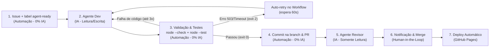

# 🤖 Autonomous Web Calculator Agent

Projeto prático de aprendizado focado em **Engenharia de Agentes de IA aplicados ao ciclo de desenvolvimento de software (SDLC)** utilizando **GitHub Actions**.

A proposta é evoluir uma calculadora web de forma incremental — **uma feature ou correção por Issue** — onde agentes autônomos recebem a demanda, implementam o código, validam com testes determinísticos, revisam o `git diff` e abrem um Pull Request pronto para aprovação humana (*Human-in-the-Loop*) com deploy automático via **GitHub Pages**.

🌐 **Demo ao vivo:** `https://VitorAlvs.github.io/calculadora-web-agent/`

---

## 🎯 Objetivo

Sair do uso manual de LLMs via chat e construir, na prática, uma esteira autônoma ponta a ponta (*Issue → Código → Testes → Revisão → PR → Deploy*), respondendo a problemas reais de engenharia:

- Onde a IA realmente precisa agir e onde automação determinística comum resolve melhor?
- Como impedir que um agente quebre código antigo, entre em loop infinito ou altere arquivos sensíveis?
- Como manter custo de tokens previsível e lidar com instabilidades reais de API (`503`, `429`, timeouts e cortes de geração)?

---

## 🔄 Workflow Autônomo (Issue → PR → Deploy)



1. **Gatilho:** Uma Issue é aberta em inglês e marcada com a label `agent-ready`. O workflow `.github/workflows/agent-dev.yml` só executa se o autor for o dono do repositório.
2. **Agente Dev (`.agent/run_agent.py`):** Lê apenas os arquivos permitidos do repositório + descrição da Issue e retorna o plano de edição em formato JSON estruturado.
3. **Portão Determinístico (`node --check` + `node --test`):** Verifica sintaxe e executa toda a suíte de testes unitários (incluindo regressão das operações anteriores). Se falhar por erro de código, o erro exato volta para o Agente Dev em um loop *Evaluator-Optimizer* (até `MAX_STEPS = 3`).
4. **Tratamento de Instabilidade (`exit code 2`):** Se todos os modelos falharem por erro transitório (`503`, `RateLimitError`, timeout ou truncamento), o script encerra com código `2` e o workflow aguarda `60s` para uma nova rodada automática antes de reportar na Issue.
5. **Branch e Pull Request:** Com os testes verdes, a esteira cria a branch `agent/issue-<N>`, faz commit/push e abre o PR com relatório de modelo, versão do prompt, tokens gastos e saída dos testes.
6. **Agente Revisor (`.agent/run_reviewer.py`):** Um segundo agente, com contexto isolado e **permissão somente leitura**, analisa o `git diff main...HEAD` contra a Issue original, publica o parecer no PR e marca o mantenedor como *Reviewer*.
7. **Aprovação Humana e Deploy:** Após revisão e merge manual na `main`, o **GitHub Pages** publica a nova versão automaticamente.

---

## 🎨 Arquitetura da Calculadora (UI Orientada por Registro)

A interface segue o formato de uma calculadora moderna em grade (`4x5`) com visor superior e slots fixos para operadores (`+`, `-`, `*`, `/`, `%`):

- **`src/calculator.js` como fonte única da verdade:** exporta `calculate(a, b, operator)` e o mapa `SUPPORTED_OPERATORS`.
- **Desbloqueio automático de botões:** ao carregar, `src/app.js` lê `SUPPORTED_OPERATORS`. Operações implementadas ganham símbolo e ficam clicáveis; operações pendentes permanecem como quadrados cinzas desabilitados.
- **Vantagem para os agentes:** cada nova operação exige alteração apenas em `src/calculator.js` e `tests/calculator.test.js`, reduzindo o consumo de tokens e eliminando o risco de quebrar HTML/CSS.

---

## 🧠 Arquitetura de IA, Modelos e Integração ("Ponte")

Para manter o orquestrador desacoplado de qualquer fornecedor único, a comunicação com os modelos segue o **padrão de API compatível com OpenAI** usando a SDK oficial `openai` em Python apontando diretamente para a **Gemini API do Google**:

- **Provedor / Endpoint ("Ponte"):** Endpoint oficial OpenAI-compatible do Google AI Studio (`https://generativelanguage.googleapis.com/v1beta/openai/`). Trocar para OpenRouter, Groq, OpenAI ou Ollama local exige alterar apenas as *Repository Secrets*, sem modificar o código Python.
- **Modelo Principal:** `gemini-3.8-flash`
- **Cadeia de Fallback Automático (1 tentativa por modelo/rodada):** `gemini-3.7-flash` → `gemini-3.6-flash` → `gemini-3.5-flash-lite` → `gemini-3.1-flash-lite`.
- **Controle de Raciocínio e Saídas Estruturadas:** Contratos validados via **Pydantic** (`AgentCodePlan` e `ReviewVerdict`) com `reasoning_effort="low"` para evitar desperdício de *thinking tokens*, tratamento explícito de `LengthFinishReasonError` e fallback para injeção de JSON Schema.

---

## 📁 Estrutura do Repositório

```text
calculadora-web-agent/
├── .agent/
│   ├── prompts/
│   │   ├── dev_v1.md            # System prompt versionado do Agente Dev (v1.2.0)
│   │   └── reviewer_v1.md       # System prompt versionado do Agente Revisor (v1.0.0)
│   ├── run_agent.py             # Orquestrador Dev + validação + fallback resiliente
│   └── run_reviewer.py          # Agente Revisor somente leitura (análise de git diff)
├── .github/
│   └── workflows/
│       └── agent-dev.yml        # Esteira CI/CD autônoma disparada por Issues
├── src/
│   ├── app.js                   # Estado do teclado, eventos e leitura de SUPPORTED_OPERATORS
│   └── calculator.js            # Lógica pura e registro SUPPORTED_OPERATORS
├── tests/
│   └── calculator.test.js       # Testes unitários nativos (node:test)
├── index.html                   # Interface da calculadora (keypad + display)
├── style.css                    # Estilização (inclui estado bloqueado dos operadores)
└── package.json                 # Configuração ES Modules + script de testes
```

---

## 🛡️ Guardrails e Segurança

- **Allowlist de escrita (*Least Privilege*):** O Agente Dev só pode escrever em `index.html`, `style.css`, `src/*.js` e `tests/*.js`. Tentativas de *path traversal* ou edição em `.github/`, `.agent/` ou `README.md` são bloqueadas antes de tocar o disco.
- **Trava de autor no workflow:** Apenas Issues criadas pelo `repository_owner` podem acionar os agentes, mitigando *prompt injection* e consumo indevido de cota em repositório público.
- **Circuit Breakers de custo e tempo:**
  - `max_tokens`: `16.384` por chamada (com `reasoning_effort="low"`).
  - `MAX_RUN_TOKENS`: `60.000` por execução.
  - `timeout`: `90s` por requisição HTTP e `timeout-minutes: 15` no job do GitHub Actions.
  - `MAX_STEPS`: `3` ciclos de auto-correção de código; relatório garantido mesmo em caso de falha ou cancelamento (`failure() || cancelled()`).
- **Human-in-the-Loop (HITL):** Os agentes nunca fazem push direto na `main`; o merge final permanece sob controle humano.

---

## 📚 O que eu aprendi na prática

1. **Automação normal segura a esteira; IA só entra onde precisa pensar:** Criar branches, rodar testes, abrir PRs e fazer deploy são etapas determinísticas (0% IA).
2. **Separação entre `/prompts` e código do agente:** Versionar prompts (`v1.0.0` → `v1.1.0` → `v1.2.0`) permite auditar na telemetria qual instrução gerou cada PR.
3. **Padronizar código, prompts e Issues em inglês economiza tokens:** Reduz a fragmentação de tokens e elimina conflitos de idioma entre interface e testes.
4. **Evitar *Retry Storms*:** Multiplicar retries internos no Python com retries externos no workflow dispara `RateLimitError` e estoura o tempo do job. O ideal é 1 tentativa por modelo na cadeia de fallback e um retry espaçado único no workflow para erros transitórios (`exit code 2`).
5. **Tokens de raciocínio (*thinking*) consomem o `max_tokens`:** Em tarefas multi-arquivo (como o redesign da UI), modelos com raciocínio podem esgotar o limite de saída antes de concluir o JSON (`LengthFinishReasonError`). Configurar `reasoning_effort="low"` e teto adequado resolve o truncamento e acelera a resposta.
6. **Arquitetura desacoplada reduz erros da IA:** Usar `SUPPORTED_OPERATORS` como fonte única da verdade permite adicionar operações sem que o agente precise reescrever HTML e CSS.
7. **Agentes seguem a especificação ao pé da letra:** Se uma Issue de redesign esquecer de mencionar uma feature anterior (como a subtração), o agente pode removê-la ou travá-la obedecendo literalmente ao escopo escrito.

---

## ⚙️ Como replicar (Configuração no GitHub)

1. **Permissões do Actions:** Em `Settings → Actions → General → Workflow permissions`, habilite **Read and write permissions** e **Allow GitHub Actions to create and approve pull requests**.
2. **Label de gatilho:** Crie a label `agent-ready` em `Issues → Labels`.
3. **Repository Secrets** (`Settings → Secrets and variables → Actions`):

| Secret | Exemplo / Descrição |
|---|---|
| `LLM_BASE_URL` | `https://generativelanguage.googleapis.com/v1beta/openai/` |
| `LLM_API_KEY` | Sua chave da Gemini API (ou outro provedor compatível com OpenAI) |
| `LLM_MODEL` | `gemini-3.8-flash` |
| `LLM_FALLBACK_MODELS` | `gemini-3.7-flash,gemini-3.6-flash,gemini-3.5-flash-lite,gemini-3.1-flash-lite` |

4. **GitHub Pages:** Em `Settings → Pages`, configure **Deploy from a branch** → `main` → `/ (root)`.

---

## 🚀 Evolução Incremental (Roadmap)

- [x] Estrutura base (HTML/CSS/ES Modules + `node --test`) e GitHub Pages
- [x] Esteira autônoma de Issue → Agente Dev → Testes → PR
- [x] Operação de Soma (`+`) — Issue #1
- [x] Agente Revisor somente leitura + notificação de revisão no PR
- [x] Operação de Subtração (`-`) — Issue #3
- [x] Redesign da UI com teclado e slots bloqueados (`SUPPORTED_OPERATORS`) — Issue #5
- [x] Fix: destravar botão de Subtração (`-`) em `SUPPORTED_OPERATORS`
- [ ] Operação de Multiplicação (`*`)
- [ ] Operação de Divisão (`/`) com tratamento para divisão por zero
- [ ] Operação de Porcentagem (`%`)